# NIKA Guide: Stargate, ATLAS and any platform

This guide covers **NIKA as it runs today**: a gateway (Stargate) sends its data to a platform (ATLAS, or any other) over an encrypted NIKA link, receives commands and writebacks back, and leans on neighbouring gateways when its own link is down.

There are two halves. Read the one that fits you:

| You are… | Read | You'll learn |
|---|---|---|
| **An operator / user** | [Part A: User guide](#part-a-user-guide) | Pairing a Stargate with ATLAS, setting up the mesh, reading the status screens, writing to a device, fixing common problems |
| **A developer** | [Part B: Developer guide](#part-b-developer-guide) | The three NIKA packages, the wire protocol, and how to plug NIKA into a new platform or gateway |
| **Anyone asking "how secure is it?"** | [Part C: Security](#part-c-security) | The encryption (what is NIKA's own and what is standard, and why), the threat model, what an attacker can and can't do, known gaps |
| **A developer who needs every detail** | [Part D: Full developer reference](#part-d-full-developer-reference) | Every public class, method, constant and error; byte layouts; timers; the core REQ/RES, PUB/SUB and STREAM models |

The interactive version of this guide, with screenshots, a pairing wizard and flow simulators, is [`nika_guide.html`](nika_guide.html).

---

## 0. NIKA in one page

NIKA is a protocol **you own**. It has three parts, and each one is a separate package you can import:

| Package | What it does | Spec |
|---|---|---|
| `nika.secure` | **NSC**, the NIKA Secure Channel: two parties prove who they are using public keys and then talk encrypted | [SECURE.md](../SECURE.md) |
| `nika.uplink` | **Uplink**: a gateway ⇄ platform session over NSC. Data goes up and is acked once *stored*; commands come down | [UPLINK.md](../UPLINK.md) |
| `nika.mesh` | **Mesh**: gateways on one LAN find each other and carry each other's traffic when one loses its link | [MESH.md](../MESH.md) |

```
                       ┌──────────── ATLAS (or any NIKA platform) ────────────┐
                       │   NikaUplinkServer :47900   ←  one public key        │
                       └──────▲───────────────────────────────▲───────────────┘
              NIKA uplink     │ (NSC, encrypted)              │ NIKA uplink
                              │                               │ (carries B as well)
   ┌──────────────────────────┴───┐   NIKA mesh (LAN)   ┌─────┴─────────────────────┐
   │ Stargate B  (uplink down)    │ ──────────────────▶ │ Stargate A  (uplink up)   │
   │ MQTT → Nectar keeps working  │   relays B's data   │                           │
   └──────────────────────────────┘                     └───────────────────────────┘
```

**Key ideas**

1. **NIKA runs alongside MQTT and doesn't replace it.** A Stargate can send to MQTT, to NIKA, or to both at once. Turning NIKA on or off never changes MQTT.
2. **Identity is a key pair.** Every gateway and every platform has an X25519 key pair. The public key is 43 characters of base64url text, and its short form is an 8-character **fingerprint** (e.g. `4f1c9a7e`). Pairing just means each side learns the other's public key.
3. **An ack means stored.** The platform acknowledges a message only after it has written it. Until then the gateway keeps the message in its outbox (`nika_outbox`) and retries. Nothing is dropped silently, and every rejection comes with a reason.
4. **Relaying is explicit.** When A carries B, the platform is told so (`UPLINK_ROUTE`) and decides whether to allow it. Data is stored under **B**, not A. Commands for B travel back through A.
5. **NIKA is only a protocol.** It knows nothing about Stargate, ATLAS, BACnet or topics. Each application plugs in through callbacks, and the application code lives in Stargate and ATLAS, never in NIKA.

---

# Part A: User guide

## A1. What you need

| Thing | Where to find it |
|---|---|
| ATLAS running, with its NIKA server on | ATLAS → **System**. The **NIKA uplink** card shows **Listening**, the address, and **ATLAS's public key** |
| A Stargate with network access to ATLAS's NIKA port (default **47900/TCP**) | Stargate UI → **Settings → NIKA** |
| An ATLAS user allowed to add gateways (and `points.write` to write to devices) | ATLAS → Users / Roles |
| *(For the mesh only)* every Stargate on the site on one LAN, plus a shared **mesh key** (16+ characters) | Settings → NIKA → Mesh |

> **Firewall:** the gateway connects *out* to the platform on 47900/TCP, so nothing has to be opened on the gateway side. The mesh uses **47800/UDP** (discovery beacons) and **47801/TCP** (relay sessions) between gateways on the LAN.

## A2. Pair a Stargate with ATLAS (5 steps)

Pairing means swapping public keys: ATLAS learns the gateway's key, and the gateway learns ATLAS's key.

### Step 1: copy ATLAS's key
ATLAS → **System** → **NIKA uplink** card. Copy the **address**, the **port** and the **public key**, and note the **fingerprint**.

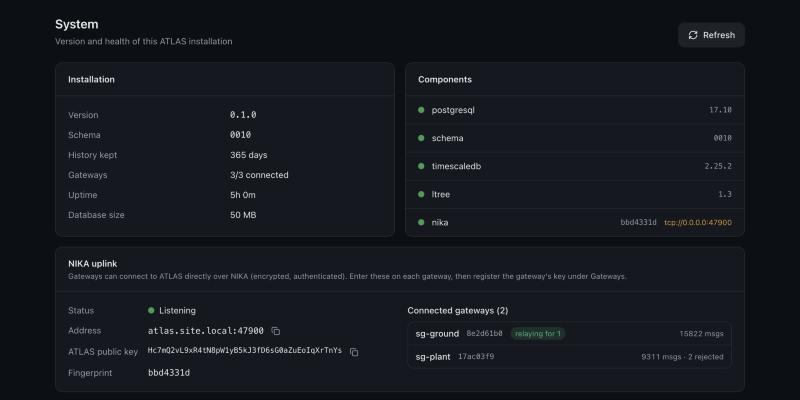

### Step 2: copy the gateway's key
Stargate UI → **Settings → NIKA → Uplink to a NIKA platform**. Copy **This gateway's key** (the copy button is next to it). Its fingerprint is shown underneath.

> The key is created the first time the page is opened, and it is stored in `<DATA_DIR>/nika/identity.key`. **Keep that file:** it *is* the gateway's identity. If it's lost, the gateway gets a new key and has to be paired again.

### Step 3: register the gateway in ATLAS
ATLAS → **Gateways → Add gateway**:
- **Transport:** choose **NIKA**.
- **Topic prefix:** the gateway's base topic, e.g. `stargate/gateway/sg-roof`. It's shown on the Stargate card as *Topic prefix*.
- **Gateway public key:** paste the key from step 2.
- **May relay for other gateways:** leave this on if this gateway should be allowed to carry its neighbours over the mesh.

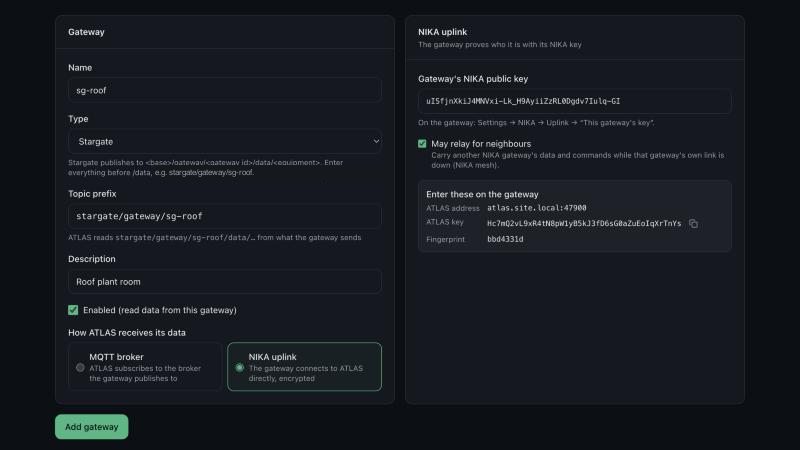

### Step 4: point the gateway at ATLAS
Back on the Stargate uplink card:
- Turn on **Uplink enabled**.
- **Platform address:** ATLAS's host name or IP. **Port:** 47900.
- **Platform public key:** paste the key from step 1.
- Click **Save & apply**. The change takes effect immediately, with no restart.

### Step 5: check both sides
- Stargate: the card badge turns **Connected**, and *Platform fingerprint* matches the fingerprint ATLAS shows.
- ATLAS: the gateway shows **Connected** with **reached directly**. Devices and points appear as data arrives.

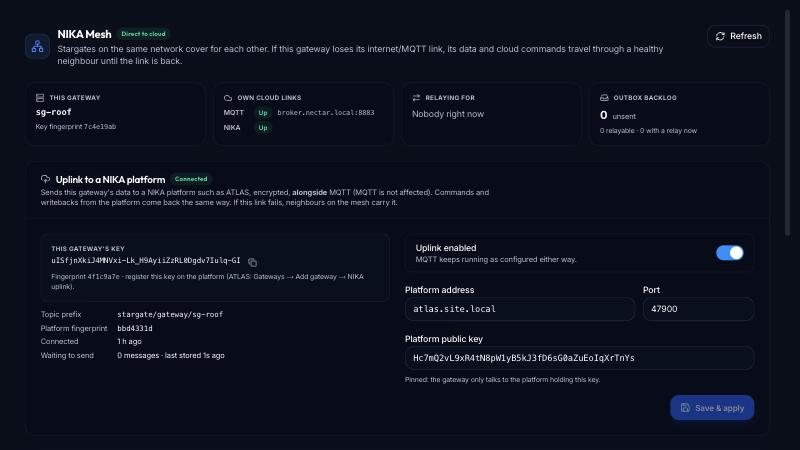

**Fingerprints are your safety check.** Compare the 8 characters on both screens. If they differ, a key was pasted wrong (or you're talking to the wrong ATLAS).

## A3. Reading the Stargate uplink card

| Badge | Meaning | What to do |
|---|---|---|
| **Connected** | The session is up. Queued data drains, and commands can arrive | Nothing |
| **Connecting** | The gateway is trying to reach the platform | Wait a few seconds. If it stays here, check the address, port and firewall |
| **Refused** | The platform answered, but it **doesn't know this gateway's key** | Register (or re-check) the gateway's key in ATLAS. The gateway retries slowly by itself |
| **Disconnected** | No link right now. Data waits in the outbox, or the mesh carries it | See *Waiting to send*; check the network |
| **Misconfigured** | The address or platform key is missing or invalid | Fill both in and save |
| **Off** | The uplink is disabled. MQTT is unaffected | Turn it on if you want NIKA |

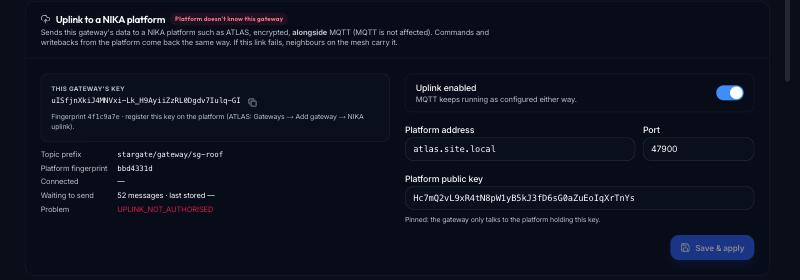

*Waiting to send* is the outbox backlog. It grows while the link is down and drains, oldest first, once it's back. A row leaves the outbox only once the platform has **stored** it.

## A4. The mesh: neighbours that cover for each other

When a Stargate loses its own link to the platform, it can send through a neighbour on the same LAN that still has one. This works for **each channel separately**:

- **MQTT channel:** the neighbour publishes B's MQTT messages on its own broker connection. The neighbour must use the *same broker*, and its ACL must allow B's topics.
- **NIKA channel:** the neighbour forwards B's NIKA data over its own NIKA uplink, marked as *B's data*. ATLAS must allow the neighbour to relay (*May relay*) and must know B. B first **proves** to the neighbour that it holds its NIKA key (a challenge on the mesh), so another device can't pass itself off as B.

### Set up the mesh
Settings → NIKA → **Mesh**: enable it, enter the **same mesh key on every gateway**, and save. Gateways on the same broadcast domain find each other in a few seconds. If broadcasts are blocked, add the neighbours as **static peers** (`host:47800`).

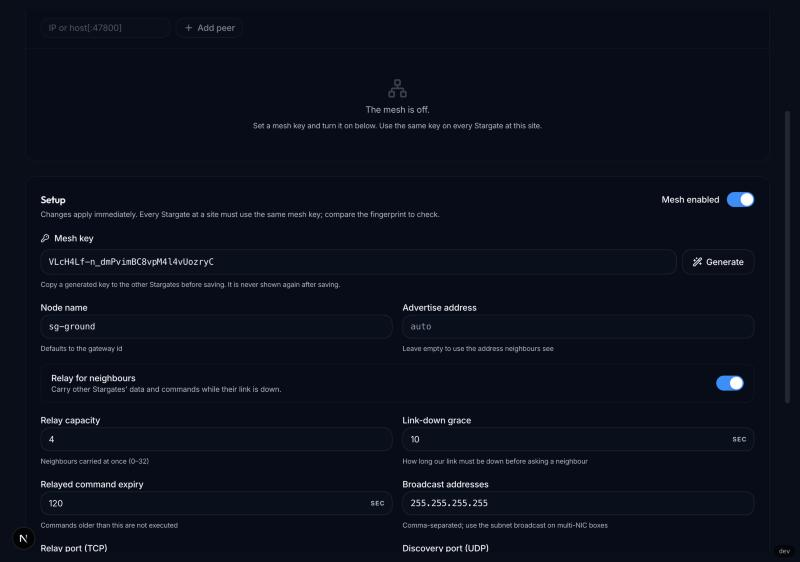

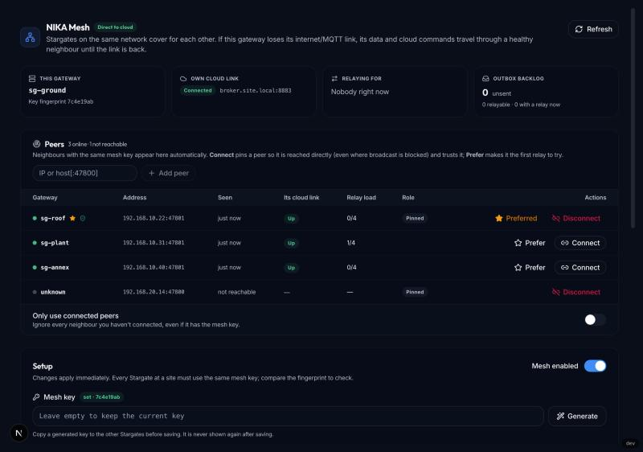

### What you'll see

| Situation | Stargate NIKA tab | ATLAS |
|---|---|---|
| All links up | **Direct to cloud** | Gateway *reached directly* |
| B's NIKA link down, A carries it | On B: **NIKA relayed via sg-ground**. *Own cloud links*: MQTT Up, NIKA Down | B: **Connected via sg-ground** |
| A is carrying someone | On A: *Relaying for* lists B | Both gateways online |
| A's broker refuses B's topics (MQTT channel) | On B: relay refused (ACL denied); B tries another neighbour | — |

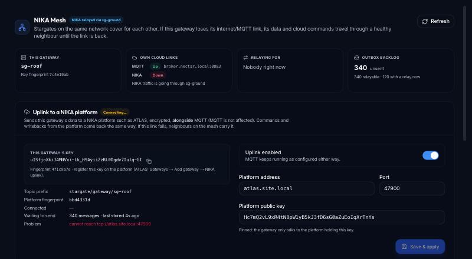

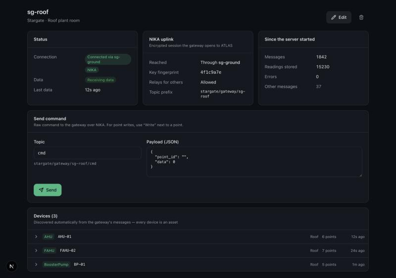

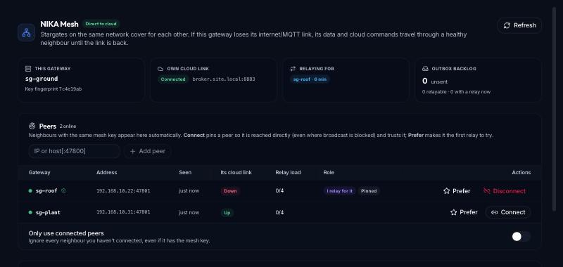

When B's own link comes back and stays up for a few seconds, B goes back to **direct** by itself. Messages that were sent through A are not sent again.

## A5. Writing to a device from ATLAS (writeback)

ATLAS → an asset or gateway page → a point row → **Write**.

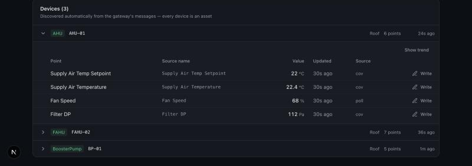

In the dialog:
- **Action:** *Set* writes a value at a priority. *Override* forces a value, optionally for a number of seconds. *Auto / release*, *Release*, *Revert* and *Cancel override* hand control back.
- **Value** (for Set/Override) and **Priority** (1–16; BACnet 8 = manual operator).
- **Send to device.** The write appears under **Recent writes** with its state and the route it took.

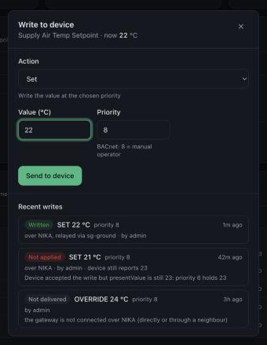

| State | Meaning |
|---|---|
| **Sent, waiting** | Delivered to the gateway; waiting for the device's answer |
| **Written** | The device accepted it |
| **Failed** | The gateway or device refused it (hover for the reason) |
| **Not applied** | The device accepted it, but a higher priority or local logic keeps another value. *Device still reports X* shows that value |
| **No answer** | No acknowledgement within 60 s |
| **Not delivered** | The gateway couldn't be reached at all (no direct session and no relay) |

The route line tells you how the write travelled: *over MQTT*, *over NIKA*, or *over NIKA, relayed via sg-ground*.

**Raw commands** (gateway page → **Send command**) send any topic suffix and JSON payload to a gateway. They're for engineers. Point writes are the safe, tracked path.

## A6. Troubleshooting

| Symptom | Likely cause | Fix |
|---|---|---|
| Stargate stuck on **Connecting** | Wrong address/port, firewall, ATLAS NIKA server not running | Check ATLAS → System → NIKA uplink shows **Listening**; test `nc -vz <atlas> 47900` from the gateway |
| **Refused** | The gateway key isn't registered in ATLAS, the gateway is disabled, or its transport isn't NIKA | Register or re-paste the key; enable the gateway |
| Connected, but the fingerprints don't match | The wrong platform key was pasted on Stargate | Re-copy ATLAS's key; the fingerprints must match |
| ATLAS NIKA uplink card shows an error *… cannot be decrypted* | ATLAS's `SECRET_KEY` changed, so its stored NIKA key can't be read | Restore the old `SECRET_KEY`. ATLAS refuses to make a new key on purpose, because every gateway would need re-pairing |
| B isn't relayed although A is up | Different mesh keys; UDP 47800 blocked; A's relay is disabled or at capacity; *May relay* is off for A in ATLAS | Same mesh key everywhere; add static peers; check the ATLAS gateway setting |
| B relayed, but ATLAS rejects B's data | B isn't registered in ATLAS, or A isn't allowed to relay | Register B; enable *May relay* on A. Until then B's NIKA data waits safely in its outbox |
| Writeback stays **No answer** | The gateway received the write but sent no ack (device offline, unknown point) | Check the Stargate logs for the `writebackId`; check the device |
| *Waiting to send* keeps growing | No link and no neighbour to relay through | Restore the network; the backlog drains by itself |
| A new gateway key after a reinstall | `identity.key` was not kept | Re-pair: replace the key in ATLAS (editing it disconnects the old session) |

---

# Part B: Developer guide

## B1. Layout and the "NIKA-specific" rule

```
NIKA/                         ← the protocol (this repo). Nothing app-specific lives here.
  nika/secure/                 NSC: handshake, sessions, keys
  nika/uplink/                 NikaUplinkServer / NikaUplinkClient
  nika/mesh/                   MeshNode, MeshConfig, CommandGuard
  nika/protocol.py             message types and error codes (UPLINK_*, RELAY_*, ERR_*)
  SECURE.md UPLINK.md MESH.md specs
  test/test_{secure,uplink,mesh}.py

Stargate/gateway/NIKA/        ← vendored copy of NIKA (import as gateway.NIKA.*)
Stargate/gateway/mqtt/nika_uplink.py   Stargate's uplink service (outbox, shim, settings)
Stargate/gateway/mqtt/mesh_bridge.py   Stargate's mesh glue (channels mqtt + nika)

ATLAS/backend/atlas/vendor/nika/       ← vendored copy (import as atlas.vendor.nika.*)
ATLAS/backend/atlas/services/nika_server.py   ATLAS's server side (authorize, store, routes)
ATLAS/backend/atlas/services/commands.py      writebacks + raw commands
```

**Rule:** anything that is about *the protocol* (crypto, framing, sessions, acks, relaying, de-duplication) goes into NIKA and is re-vendored. Anything that is about *an application* (which keys are allowed, how data is stored, what a topic means, UI) goes into the application, through NIKA's callbacks. That is why NIKA's server takes `authorize`, `on_data` and `on_route` callables instead of a database.

**Preferred:** install NIKA as a package (`pip install "nika-protocol @ git+https://github.com/saran-raj-dev/NIKA@v1.0.0"`) and import `nika.*`. Vendoring still works: copy `nika/{secure,uplink,mesh,protocol.py,envelope.py}` plus the specs. Imports inside NIKA are relative, so the copy works under any package name.

## B2. NSC: the secure channel (`nika.secure`)

- **Pattern:** Noise-IK style. The client already knows the server's static public key, so the handshake is one round trip, and both static keys are authenticated.
- **Primitives (all from `cryptography`):** X25519, ChaCha20-Poly1305, HKDF-SHA256, SHA-256. The protocol name `NIKA-NSC-v1/IK/X25519/ChaChaPoly/SHA256` is mixed into the transcript hash.
- **Handshake:** message 1 carries `e`, then the encrypted client static `s`, then an encrypted payload (with a timestamp; the window is ±120 s). Message 2 carries the server's `e` and an encrypted payload. Keys are derived from `ee`, `es`, `se`, `ss`, with separate send and receive keys.
- **Transport:** every frame has a 64-bit counter used as the nonce and as AAD. Counters must strictly increase (replays and reordering are rejected). Each direction rekeys every 2²⁰ frames or every hour.
- **Keys:** `StaticKey.generate() / load_or_create(path)` (file mode 0600), `public_b64` (43 chars), `fingerprint` = first 8 hex characters of SHA-256(public key). `parse_public_key(text)` validates the format (note that any 32 bytes is a valid X25519 key, so format is all that can be checked).

```python
from nika.secure import StaticKey, ClientHandshake, ServerHandshake, parse_public_key
server, client = StaticKey.generate(), StaticKey.generate()
hs_c = ClientHandshake(client, server.public)            # client knows the server key
hs_s = ServerHandshake(server)
client_static = hs_s.read_message1(hs_c.write_message1())  # server learns + authenticates client
m2, s_sess = hs_s.write_message2()
c_sess, _ = hs_c.read_message2(m2)
assert s_sess.decrypt(c_sess.encrypt(b"hi"))[1] == b"hi"
```

You normally never touch NSC directly: the uplink uses it for you.

## B3. Uplink: gateway ⇄ platform (`nika.uplink`)

**Transport:** ZeroMQ DEALER (client) ⇄ ROUTER (server) over TCP, default port **47900**. Frames: `H1`/`H2` (handshake), `D` (NSC-encrypted JSON), `E` (plaintext refusal, only `UPLINK_NOT_AUTHORISED`). The maximum message size is 1 MiB.

| Message | Direction | Fields | Notes |
|---|---|---|---|
| `UPLINK_HELLO` / `UPLINK_WELCOME` | c→s / s→c | `meta` / `peer_id` | `meta` is app-defined (Stargate sends `base_topic`, `gateway_id`, `software`) |
| `UPLINK_DATA` → `UPLINK_ACK` | c→s → s→c | `msg_id, topic, p\|pb, qos, origin?` → `msg_id, ok, reason?` | The ack is sent **after** `on_data` returns |
| `UPLINK_ROUTE` | c→s | `origin, active` | "I carry `origin`". The server asks `on_route` |
| `UPLINK_CMD` → `UPLINK_CMD_ACK` | s→c → c→s | `command_id, topic, p\|pb, expires_at?, target?` → `command_id, status, detail?` | `target` is set when the command is for a peer the client relays for |
| `UPLINK_PING` / `PONG` / `BYE` | both | — | Heartbeat every 5 s; the server drops a session after 30 s of silence |

**Guarantees**
- An **ack means stored.** `publish()` returns only after the server application has stored the message. It raises `UplinkError(reason)` on a rejection and `UplinkUnavailable` when the outcome is unknown (retry; de-duplicate on `msg_id`).
- Messages from one peer are processed **in order**, and there is **one session per peer** (a new session replaces the old one).
- **Commands** are de-duplicated by `command_id` and refused when expired, *before* your handler runs. Statuses: `accepted`, `duplicate`, `expired`, `rejected`, `failed`, or your own.
- **Routes** are replayed after a reconnect and dropped when the relay's session ends. Concurrent `announce_route()` calls for one origin share one request.

**Errors:** `UPLINK_NOT_AUTHORISED`, `UPLINK_ORIGIN_DENIED`, `UPLINK_STORE_FAILED`, `UPLINK_UNAVAILABLE`, `UPLINK_BAD_MESSAGE`, or any reason string your `on_data` returns.

## B4. Mesh: LAN relaying (`nika.mesh`)

- **Discovery:** HMAC-signed UDP beacons on **47800** (broadcast and/or static peers). Each beacon advertises the node's per-channel uplink state, e.g. `{"mqtt": true, "nika": false}`.
- **Relay sessions:** ZeroMQ on **47801/TCP**, framed and MAC'd with the site's `mesh_key`. An *origin* opens a session to a *relay*. The relay calls your `on_uplink_publish(UplinkRequest)`, and you call `req.ack()` or `req.fail(reason)` once your upstream accepted (or refused) it.
- **Channels:** `node.set_uplink(up, channel="nika")` per channel. An origin looks for a relay as soon as any channel it uses is down. A relay accepts a channel only while that channel is up on its side. `send(..., channel=)` chooses the channel. Single-channel callers keep working (`DEFAULT_CHANNEL`).
- **Selection:** `preferred_relays` are tried first. A relay that failed is avoided for `relay_cooldown` (30 s). `revoke(origin, reason)` ends a neighbour's session (e.g. ACL denied or wrong broker), and the origin fails over.
- **Commands down the mesh:** `forward_command(origin, …)` on the relay; `on_command(Command)` on the origin. Share one `CommandGuard` between the uplink and the mesh so a command that arrives both ways runs once.
- **Session meta:** `set_session_meta({...})` on the origin, `session_meta(origin)` on the relay. Stargate uses it to check that both gateways talk to the *same* platform (by server fingerprint) before relaying the NIKA channel. Meta is **self-declared**: never use it to decide *who* the origin is.
- **Origin identity:** `set_identity(static_key)` on the origin (Stargate passes its NIKA key). On every `RELAY_OPEN` the relay challenges the origin to prove it holds that key, and `session_identity(origin)` on the relay returns the **proven** 32-byte key, or `None`. `require_identity=True` makes a relay refuse origins that don't prove one. Details in C5.

## B5. Integrating a platform (ATLAS is the reference)

A NIKA platform needs four things: **a key, a server, an authorisation rule, and a store**.

```python
from nika.secure import StaticKey, fingerprint
from nika.uplink import NikaUplinkServer, DataMessage

key = load_or_create_platform_key()          # keep it safe; it IS the platform identity

async def authorize(client_public: bytes) -> str | None:
    """Return a peer id (we use the key text) if this key belongs to a known, enabled gateway."""
    gw = await db.gateway_by_key(key_text(client_public))
    return key_text(client_public) if gw else None

async def on_data(dm: DataMessage) -> str | None:
    """Store, then return None (= ack ok) or a reason string (= explicit reject)."""
    gw = await db.gateway_by_key(dm.origin)  # dm.origin != dm.peer_id when relayed
    if gw is None:
        return "UPLINK_ORIGIN_DENIED"
    await store(gw, dm.topic, dm.payload)    # commit BEFORE returning
    return None

async def on_route(relay: str, origin: str, active: bool) -> bool:
    """May `relay` carry `origin`? Called when a relay announces a route."""
    return (await db.gateway_by_key(relay)).relay_allowed and await db.gateway_by_key(origin) is not None

server = NikaUplinkServer(key, bind="tcp://0.0.0.0:47900", authorize=authorize, on_data=on_data,
                          on_route=on_route, on_session=on_session, on_command_ack=on_command_ack)
await server.start()

route = await server.send_command(peer_id, "stargate/gateway/sg-roof/cmd", payload_json,
                                  command_id=str(uuid4()), expires_at=time.time() + 120)
# route: 'direct' | relay peer_id | None (unreachable → mark the write "undeliverable")
```

**How ATLAS does it** (`backend/atlas/services/nika_server.py`):
- The key is created on first start and stored **encrypted** (Fernet with `SECRET_KEY`) in `system_secrets`, so it survives upgrades and backups. If it can't be decrypted, ATLAS refuses to replace it.
- `authorize`: an **enabled** gateway with `transport = 'nika'` and a matching `nika_public_key`.
- `on_data` → `IngestManager.ingest(gateway_id, topic, payload)`, the **same** single entry point the MQTT path uses (parse with the Stargate connector and store). Topics ATLAS doesn't use are acked and ignored, because NIKA carries *everything* a gateway publishes.
- `on_route`: the relay must have `nika_relay_allowed` and the origin must be a known NIKA gateway. The UI then shows *Connected via \<relay\>*.
- Editing or disabling a gateway calls `server.disconnect(old_key)`.
- Writebacks (`services/commands.py`):
  1. `POST /api/points/{id}/writeback` builds Stargate's payload (`point_id`, `data`, `priority`, `writebackId`, the command type) and sends it to `<prefix>/cmd` over NIKA (direct or relayed), or over MQTT for MQTT gateways.
  2. The gateway's answer arrives as ordinary data on `<prefix>/ack/cmd`. It is matched by `writebackId`, and **NOT_APPLIED supersedes SUCCESS**.
  3. A sweeper marks rows with no answer after `writeback_timeout_s` (60) as `timeout`.

**ATLAS settings:** `NIKA_ENABLED` (true), `NIKA_BIND` (0.0.0.0), `NIKA_PORT` (47900), `NIKA_ADVERTISE_HOST` (the address shown to operators), `COMMAND_TTL_S` (120), `WRITEBACK_TIMEOUT_S` (60).

**ATLAS API:**

| Endpoint | Purpose |
|---|---|
| `GET /api/nika` | Server state, endpoint, public key, fingerprint, live sessions |
| `POST /api/gateways` with `transport: "nika"`, `nika_public_key`, `nika_relay_allowed` | Register a NIKA gateway |
| `GET /api/gateways/{id}` | Includes `nika_session` (`route`: `direct` or the relay's name) |
| `POST /api/points/{id}/writeback` | `{command_type, value?, priority, duration_s?}` (`points.write`) |
| `GET /api/points/{id}/writebacks`, `GET /api/writebacks/{id}` | History and state |
| `POST /api/gateways/{id}/commands` | A raw topic suffix + JSON payload (`gateways.command`) |

**Building another platform?** Copy that shape: any language with ZeroMQ, X25519, ChaCha20-Poly1305 and HKDF can implement the spec. In Python, vendor NIKA and write the four callbacks. Store before you ack, de-duplicate on `msg_id`, and always reject with a reason.

## B6. Integrating a gateway (Stargate is the reference)

```python
from nika.secure import StaticKey, parse_public_key
from nika.uplink import NikaUplinkClient, UplinkError, UplinkUnavailable

key = StaticKey.load_or_create("/data/nika/identity.key")
client = NikaUplinkClient(key, parse_public_key(PLATFORM_KEY), endpoint="tcp://atlas:47900",
                          meta={"base_topic": BASE, "gateway_id": GW}, on_command=handle_command)
await client.start()

# drain a durable outbox, oldest first
for row in outbox.unsent():
    try:
        await client.publish(row.topic, row.payload, msg_id=f"{GW}:nk:{row.id}")
        outbox.mark_sent(row.id)               # only after the platform stored it
    except UplinkUnavailable:
        break                                  # link dropped: try again later (or via the mesh)
    except UplinkError as e:
        outbox.mark_failed(row.id, e.reason)   # explicit rejection: don't retry forever

async def handle_command(cmd) -> str:
    if cmd.target:                             # for a neighbour we relay for
        return await mesh_forward(cmd)
    await run_locally(cmd.topic, cmd.payload)  # then publish the ack as normal data
    return "accepted"
```

**How Stargate does it:**
- **One tap, MQTT untouched.** `MQTTService.publish()` hands each message to `NikaUplinkService.enqueue()` when the uplink is enabled. The tap never raises, and it is a no-op when NIKA is off (`gateway/mqtt/client.py`).
- **A durable outbox:** the `nika_outbox` table (Flyway `V54`), written in batches. The sender drains it with up to 50 publishes in flight and the server keeps them in order. Rows are pruned like `mqtt_outbox`.
- **Commands** go through the normal MQTT command handlers via `PublishShim`, so a writeback's ack (`<base>/ack/cmd`) is published like any other message and reaches the platform over NIKA (and over MQTT, if MQTT is on).
- **Mesh NIKA channel** (`gateway/mqtt/mesh_bridge.py`):
  - While the uplink is down, `relay_nika_tick()` sends unsent outbox rows over the mesh on `channel="nika"`.
  - The relay checks the origin's session meta (same platform fingerprint), takes B's NIKA key **only from `session_identity()`** (the key B proved on the mesh; an unproven neighbour gets `RELAY_IDENTITY_REQUIRED`), announces `UPLINK_ROUTE`, and publishes with `origin=B`.
  - If ATLAS refuses the route, the relay refuses each of B's messages with `RELAY_ACL_DENIED`. B keeps them in `nika_outbox`, pauses NIKA relaying for 15 s and tries again. Nothing is lost.
  - Commands with a `target` are forwarded with `forward_nika_command`, only to the mesh session whose **proven** key is that target.
- **Identity:** `<DATA_DIR>/nika/identity.key`, or `NIKA_IDENTITY_PATH`.

**Stargate settings** (`.env`, overridden live by Settings → NIKA, stored in `gateway_settings.meta`):

| Setting | Default | Meaning |
|---|---|---|
| `NIKA_UPLINK_ENABLED` | false | Turn the uplink on |
| `NIKA_UPLINK_HOST` / `NIKA_UPLINK_PORT` | — / 47900 | The platform's address |
| `NIKA_UPLINK_SERVER_KEY` | — | The platform's public key (43 chars) |
| `NIKA_IDENTITY_PATH` | `<DATA_DIR>/nika/identity.key` | This gateway's key file |
| `MESH_ENABLED`, `MESH_KEY` | false, — | The mesh, and the site-wide key (16+ chars) |
| `MESH_PORT` / `MESH_DISCOVERY_PORT` | 47801 / 47800 | Relay TCP / beacon UDP |
| `MESH_STATIC_PEERS` | — | `host:udp_port,…` when broadcast is blocked |
| `MESH_RELAY_ENABLED`, `MESH_RELAY_CAPACITY` | true, 4 | Carry neighbours, and how many at once |
| `MESH_UPLINK_GRACE_S` | 10 | How long a link must be down before seeking a relay |

**Stargate API:** `GET/PUT /api/nika/uplink` (status, settings, key, backlog; PUT requires admin) and `GET /api/mesh/status`, `PUT /api/mesh/config`.

## B7. Testing

| Where | Command | Covers |
|---|---|---|
| NIKA | `python -m pytest test/test_secure.py test/test_uplink.py test/test_mesh.py` | Handshake, tampering, replay, wrong key, rekey, pre-shared key; uplink round trip, reconnect, routes, commands, psk mismatch, session takeover; mesh channels, failover, revoke, origin identity proof, impostors, takeover |
| ATLAS | `cd backend && python3.11 -m pytest tests/test_nika_uplink.py` | Real NIKA clients against ATLAS's server and Postgres: pairing, relaying, writeback states, permissions |
| Stargate | `python -m pytest tests/test_nika_*` | The tap is a no-op when off, outbox replay, the command shim, the mesh NIKA channel (incl. a neighbour claiming another gateway's key), settings API |

Every test uses real sockets on localhost. An end-to-end run (ATLAS + two Stargates, B relayed through A, writeback round trip) passed 16/16 checks.

## B8. Security

Security has its own part: [Part C](#part-c-security).


---

# Part C: Security

## C1. "Our own encryption": what is NIKA's, and what isn't

The goal was a **custom, hard-to-break encryption model of our own**. NIKA has one, and it is the **NIKA Secure Channel (NSC)**. Here is exactly what "our own" covers:

| Layer | Whose | What it is |
|---|---|---|
| **Protocol design** | **NIKA's own** | The handshake shape (which keys are combined, in what order), the message layout, the frame header, the key schedule and its labels (`NIKA-NSC-v1…`), the rekey rule, the replay rules, the identity and fingerprint format, the key-file format, the error behaviour. Nobody else speaks NSC. A standard TLS, Noise or SSH client cannot talk to a NIKA server |
| **Building blocks (primitives)** | Standard, public | X25519 (key agreement), ChaCha20-Poly1305 (encryption + integrity), HKDF-SHA256 / SHA-256 (key derivation, hashing). These are the same ones used by WireGuard, Signal, TLS 1.3 and SSH |

**Why not invent the cipher itself as well?** Because a cipher's strength comes from mathematics that has survived years of public attack, not from secrecy:

- **Kerckhoffs's principle:** a system must stay secure even if the attacker knows *everything* about it except the keys. Secret algorithms are routinely reverse-engineered from the software (anyone with a Stargate image has the code). After that, all that's left is the algorithm's real strength.
- **Home-made ciphers fail badly and quietly.** They look fine in tests, then fall to standard techniques (differential and linear cryptanalysis, nonce reuse, timing). Examples include the GSM ciphers A5/1 and A5/2, MIFARE Crypto-1, and the DVD's CSS. All were secret, custom, and broken.
- **Proven primitives are "hard to break" in a measurable way:**

| Primitive | Security level | What breaking it means |
|---|---|---|
| X25519 | ≈ 2¹²⁸ operations | Recovering a private key from a public key. Far beyond all computers on Earth for billions of years |
| ChaCha20-Poly1305 | 256-bit key, 128-bit tag | Decrypting without the key is a 2²⁵⁶ search; forging a frame succeeds with probability ≈ 2⁻¹⁰⁶ per attempt |
| SHA-256 / HKDF | 128-bit collision, 256-bit pre-image | Deriving one session key from another is infeasible |

So NIKA's "secret sauce" is **its own protocol**, built on primitives nobody can practically break. **The keys** are what must stay secret: the private key files and ATLAS's `SECRET_KEY`.

> **Want something "known only to us" on top?** Turn on the deployment-wide **pre-shared key**: a 32-byte secret mixed into the NSC handshake (Noise `IKpsk2` pattern, see [C3](#c3-nsc-in-full-detail)). Then even someone with a valid key pair *and* the NIKA source can't open a session without that secret. It's optional and off by default (`psk=` on `NikaUplinkServer` / `NikaUplinkClient`).

## C2. The three security layers in NIKA

| Layer | Protects | Confidential (encrypted)? | Authenticated? | Replay-safe? |
|---|---|---|---|---|
| **NSC uplink** (gateway ⇄ platform) | All data, commands and acks between Stargate and ATLAS | **Yes**, ChaCha20-Poly1305 | **Yes, both sides**, by public key | **Yes**: counters, plus remembered handshake ephemerals |
| **Mesh** (gateway ⇄ gateway, LAN) | Relay sessions, beacons | **No**: readable on the LAN | Yes: HMAC-SHA256 with the **site mesh key** (shared); the origin's own key is **proven** to the relay by a challenge | Yes: frame ids remembered inside a ±120 s window; fresh nonce per identity challenge |
| **Core models** (REQ/RES, PUB/SUB, STREAMS: `nika/server.py`) | Internal apps on a private network | **No** | API key at `CLIENT_JOIN` (demo keys in `nika/auth.py`) | REQ/RES idempotency only |

**Rule of thumb:** the uplink is safe to run over untrusted networks, including the internet. The mesh is safe on a site LAN you control. The core models are for localhost, a VPN or a private VPC (see `SECURITY.md`).

## C3. NSC in full detail

### Keys and identities
- **Static key:** X25519, 32-byte public key. It's shown as base64url without padding (43 chars).
- **Fingerprint:** `sha256(public)[:8 hex]`. This is for humans; it's **not** a security boundary on its own (2³² possibilities). The *full* key is what's pinned and checked.
- **Key file** (`StaticKey.save`), created with mode `0600`:
  ```
  NIKA-NSC-KEY v1
  private <base64url 32 bytes>
  public  <base64url 32 bytes>
  ```
- The **server key is pinned** by the client (the "Platform public key" field). The client never talks to a server holding another key, so there's no trust-on-first-use window and no certificate authority.

### Handshake state machine
State is a Noise-style **chaining key** `ck` and **transcript hash** `h`. Every public value and ciphertext is mixed into `h` and used as AEAD associated data, so any change to the transcript breaks the next tag.

```
init      h = SHA256("NIKA-NSC-v1/IK/X25519/ChaChaPoly/SHA256");  ck = h
          h = SHA256(h ‖ S_pub)                                   # server static, known to both

message 1 (client → server)      bytes: 0x01 ‖ e_pub(32) ‖ enc_s(32+16) ‖ enc_payload(8+n+16)
          h  = SHA256(h ‖ e_pub)
          ck, k = HKDF(ck, DH(e, S))            # es  → first key; only the real server can follow
          enc_s = AEAD(k, n=0, ad=h, C_pub);    h = SHA256(h ‖ enc_s)
          ck, k = HKDF(ck, DH(C, S))            # ss  → proves the client owns C
          enc_payload = AEAD(k, n=0, ad=h, ts_u64 ‖ app_payload); h = SHA256(h ‖ enc_payload)

server    decrypts C_pub, checks |now − ts| ≤ 120 s, rejects a repeated e_pub, then authorize(C_pub)

message 2 (server → client)      bytes: 0x01 ‖ f_pub(32) ‖ enc_payload(n+16)
          h  = SHA256(h ‖ f_pub)
          ck, k = HKDF(ck, DH(f, e))            # ee  → forward secrecy
          ck, k = HKDF(ck, DH(f, C))            # se  → proves the server owns S (with es)
          enc_payload = AEAD(k, n=0, ad=h, {"server": fingerprint})

split     k_c2s, k_s2c = HKDF(ck, "")           # one key per direction
```
`HKDF(ck, ikm)` = HMAC-SHA256 extract with `ck` as the salt, then two expand blocks (`0x01`, then `out1 ‖ 0x02`), exactly as in Noise.

### Optional pre-shared key (IKpsk2)
With `psk=` on both sides (32 random bytes, `generate_psk()` makes one as text):
```
init      h = SHA256("NIKA-NSC-v1/IKpsk2/X25519/ChaChaPoly/SHA256");  ck = h;  h = SHA256(h ‖ S_pub)
message 1 0x02 ‖ …    as above, but after h = SHA256(h ‖ e_pub) also  ck, k = HKDF(ck, e_pub)
message 2 0x02 ‖ …    as above (with ck, k = HKDF(ck, f_pub) after f), then after se:
          ck, h', k = HKDF(ck, psk, 3 outputs);  h = SHA256(h ‖ h')     # psk
          enc_payload = AEAD(k, n=0, ad=h, …)
```
- **Version byte `0x02`:** a psk peer and a plain peer fail on the very first byte with a clear `NSCError`, not on a puzzling tag error. The different protocol name means the two transcripts can never match.
- **What it adds:** nobody without the psk can read message 2 or derive the session keys. That includes a thief of a gateway's `identity.key`. The server still reads message 1 without the psk, so a stranger costs it the same two DH operations (C7 gap 3 is unchanged).
- **The uplink server switches sessions only after the new session's first frame authenticates**, so a valid message 1 without the psk can't knock out the live session either.
- **Rolling out:** platform and gateways switch together. A psk server refuses all plain clients, and a plain server refuses all psk clients.

### Transport frames
```
offset  size  field
0       1     version   (1)
1       1     epoch     (0…255, rekey generation)
2       2     kind      (application-defined; the uplink uses 0)
4       8     counter   (big-endian, per direction, per epoch)
12      n+16  ChaCha20-Poly1305(key[epoch], nonce = 00000000 ‖ counter_LE64, plaintext, ad = bytes 0–11)
```
- **Integrity of the header:** the 12 header bytes are the associated data. Flip any bit of version, epoch, kind or counter and the tag fails.
- **Replay and reorder:** a frame whose counter is lower than the next expected one is rejected. Gaps are allowed (TCP keeps order). State changes **only after** the tag verifies, so injected garbage can't desynchronise a session.
- **Rekey:** after 2²⁰ frames or 3600 s, the sender sets `key ← HKDF(key, "NIKA-NSC-v1 rekey")[0]`, `epoch += 1` and `counter = 0`. The receiver accepts only `epoch` or `epoch+1`. After epoch 255 the session is exhausted and must reconnect (a reconnect costs one round trip). Old keys can't be computed back from new ones.
- **Errors:** `NSCError` never tells the peer which check failed. A bad handshake gets **no reply at all**. Only a *valid* handshake from an *unknown* key gets the `E {UPLINK_NOT_AUTHORISED}` frame, and to send that, the client must already have proved it owns the key.

### Properties, and the attack each one blocks

| Property | Blocks |
|---|---|
| Server authentication (pinned `S`, `es`+`se`) | A fake platform / man-in-the-middle: without S's private key it can't produce message 2 |
| Client authentication (`ss`, encrypted `C`) | A fake gateway: without C's private key it can't produce message 1's final tag |
| Identity hiding (`C` encrypted) | Passive observers learning which gateway is connecting |
| Forward secrecy (`ee`, ephemerals) | A future key theft decrypting recorded traffic |
| Timestamp window + remembered ephemerals | Replaying a captured message 1 to hijack or reset a session |
| Counters in authenticated header | Replaying, reordering or truncating-and-splicing frames |
| Low-order point check | Small-subgroup / all-zero shared-secret tricks |
| Transcript hash in AEAD | Downgrade or tampering with any handshake byte |

## C4. Uplink security (what the server enforces)

- **Authorisation on every connect:** `authorize(public_key)` is asked *after* the client has proved it holds the key. ATLAS accepts only an **enabled** gateway with `transport = 'nika'` and that exact key.
- **One session per identity:** a new authenticated session replaces the old one, once its first encrypted frame authenticates (a bare message 1 can't). Editing or disabling a gateway in ATLAS calls `disconnect()` immediately.
- **Optional pre-shared key:** with `psk=` set, a client also needs the deployment secret to finish a handshake (C3).
- **Relaying is an explicit permission:** data with an `origin` other than the sender needs an accepted `UPLINK_ROUTE` first, otherwise it gets `UPLINK_ORIGIN_DENIED`. ATLAS allows a route only if the relay has *May relay* on and the origin is a known NIKA gateway.
- **Commands:** each has a unique `command_id` and an `expires_at`. The client refuses duplicates and expired commands *before* the app sees them. The writeback itself is still checked by Stargate's normal command handler.
- **Resource limits:** 1 MiB per ZeroMQ message (`MAXMSGSIZE`); a 10,000-message queue per session (beyond that → `UPLINK_STORE_FAILED`, and the gateway retries); silent sessions dropped after 30 s; malformed messages rejected with `UPLINK_BAD_MESSAGE`.
- **The platform's key at rest (ATLAS):** Fernet-encrypted with `SECRET_KEY` in `system_secrets`. ATLAS refuses to silently generate a new one if it can't decrypt the stored one.

## C5. Mesh security

- **Link MAC:** every mesh frame, beacons included, carries `HMAC-SHA256(mesh_key, canonical_json(frame))`, checked in constant time. Frames with a bad MAC are dropped silently.
- **Freshness:** each frame has a timestamp (±120 s) and a unique `id`. Ids are remembered for twice the window, so a captured frame can't be replayed.
- **Binding:** the ZeroMQ identity must equal the envelope's `sender`. An origin accepts frames only from the relay it chose. `allowed_peers` can restrict which node ids may take part.
- **Rate and capacity:** per-origin token bucket (200 msg/s, priority 0 exempt), `relay_capacity` origins at once, idle sessions dropped after 10 s.
- **Origin identity (proof of key possession):** an origin with a long-term key (Stargate: its NIKA key) claims it in `RELAY_OPEN`. The relay answers with `RELAY_CHALLENGE {n, e}` (a fresh 32-byte nonce and a fresh X25519 ephemeral `E`). The origin returns `RELAY_PROVE {mac}`, where `k = HKDF(SHA256(label ‖ n), DH(S, E))` and `mac = HMAC-SHA256(k, relay id ‖ origin id ‖ n ‖ E ‖ S_pub ‖ SHA256(meta))` (canonical JSON). Only the holder of S's private key can compute it. The relay accepts the session only if the MAC matches, and exposes the proven key as `session_identity(origin)`. The ephemeral is used once, and both node ids and the meta are in the MAC, so a proof can't be replayed, forwarded to another relay, or reused with different meta. If a node id re-opens its session with a different identity (or none), the relay ends the old session first, so taking over a node id doesn't inherit its proven key. `require_identity=True` refuses origins that prove nothing.
- **Platform check for the NIKA channel:** before relaying NIKA data, the relay compares the origin's declared platform fingerprint with its own (`RELAY_WRONG_BROKER` otherwise), and names the origin to the platform **only by its proven key** (`RELAY_IDENTITY_REQUIRED` if it proved none). Targeted commands are forwarded only to the session that proved the target key. The platform then authorises the route (C4).
- **Optional origin signatures:** `MeshNode(signer=OriginSigner(ed25519_pem))` signs `(origin, msg_id, topic, payload, ts)`. `verify_origin()` lets a platform prove that relayed data really came from the origin. **Stargate and ATLAS don't use this yet.**

## C6. Threat model: what each attacker can and can't do

| Attacker | Can | Cannot |
|---|---|---|
| **Internet eavesdropper** on the uplink path | See that some TCP traffic goes to port 47900, and its timing and volume | Read data or commands; learn which gateway it is; replay or alter anything |
| **Active man-in-the-middle** on the uplink | Drop or delay traffic (the gateway queues it and retries, or relays over the mesh) | Impersonate ATLAS (pinned key), impersonate a gateway, inject or modify messages |
| **Stranger with their own key pair** | Send a message 1 and be told `UPLINK_NOT_AUTHORISED` (with a pre-shared key on: never derive session keys) | Send data or receive commands; their key isn't registered |
| **Thief of one gateway's `identity.key`** | Act as **that** gateway until its key is replaced in ATLAS (with a pre-shared key on: only if they also have the psk) | Act as other gateways; decrypt past sessions (forward secrecy); replace the live session without completing the handshake |
| **Thief of the platform key** (+ `SECRET_KEY`) | Impersonate the platform to gateways that pin it | Decrypt past sessions. Fix: rotate the platform key and re-pin it on the gateways |
| **Someone on the site LAN *without* the mesh key** | See mesh traffic (**it's not encrypted**), including relayed readings and commands | Inject, alter or replay mesh frames; join the mesh |
| **Someone on the site LAN *with* the mesh key** (or a compromised gateway) | Read mesh traffic; offer to relay and then drop data; open a relay session under its own (or no) identity | Break NSC or read the uplink; **be carried or commanded as another gateway** (the relay only trusts a key the origin proved, C5) |
| **Compromised relay gateway** | Read or drop the traffic it relays | Forge data **if** origin signatures are verified (not enabled today; see C8) |

## C7. Known gaps (honest list)

1. **The mesh is authenticated but not encrypted.** Relayed readings and commands can be read by anyone on the LAN segment. *Mitigation today:* keep the mesh on a trusted VLAN. *Fix:* see C8 (end-to-end NSC through the relay).
2. **One shared mesh key per site.** Anyone who has it is a full mesh member. Rotating it means updating every gateway. There's no per-node revocation except `allowed_peers`.
3. **Handshake cost.** Every message 1 costs the server two X25519 operations before it can reject. NIKA has no per-IP handshake rate limit, so a flood of handshakes can load the CPU. *Mitigation:* firewall port 47900 to the networks the gateways connect from.
4. **The mesh has no message size cap** at the socket level (the uplink caps at 1 MiB). Only mesh members (holders of the key) can send frames that are processed.
5. **Clock dependence.** Handshakes and mesh frames need clocks within ±120 s. *Run NTP on gateways and on the platform.*
6. **The core models** (`nika/server.py`: REQ/RES, PUB/SUB, STREAMS) are unencrypted and use API keys hard-coded in `nika/auth.py` for the demo. Don't expose them beyond localhost or a private network, and replace the keys before any real use.
7. **The fingerprint is short** (32 bits). It's fine for a human sanity check, but the software always compares the full key, and people shouldn't treat a matching fingerprint as proof against a deliberate attacker.

**Closed since the first review** (no longer gaps):
- **Mesh origins were self-declared.** A device with the site mesh key could open a relay session claiming another gateway's NIKA key and be carried (and commanded) as it. Now the origin must **prove** its key to the relay (C5), and Stargate uses only the proven key for the NIKA channel and for targeted commands.
- **No secret beyond the key pairs.** NSC now has an optional deployment **pre-shared key** (IKpsk2, C3).

## C8. Roadmap: hardening options

| Option | Closes | Effort |
|---|---|---|
| **End-to-end NSC through the relay:** the origin keeps its own NSC session to the platform, and the relay only carries encrypted frames | Gap 1 completely, and forgery by a relay (the relay sees nothing and can't alter anything) | Medium: a new relayed-frame message in the uplink and mesh |
| **Verify origin signatures in ATLAS** (`OriginSigner` / `verify_origin`, Ed25519) | Forgery by a relay | Small–medium (needs a per-gateway signing key) |
| **Encrypt the mesh** (NSC between neighbours, keys derived from the site key or per-node keys) | Gap 1 | Medium |
| **Handshake rate limiting** per source | Gap 3 | Small |
| **NSC for the core models** | Gap 6 | Medium |

Done: **proof of key possession on `RELAY_OPEN`** (C5) and the **deployment pre-shared key in NSC** (C3).

## C9. Operator security checklist

- [ ] Keep `identity.key` (gateways) and ATLAS's `SECRET_KEY` and database backups private; don't copy them into tickets or chat.
- [ ] Compare **fingerprints** when pairing. If a gateway suddenly needs re-pairing, find out why before accepting a new key.
- [ ] Firewall ATLAS's 47900/TCP to the networks your gateways connect from.
- [ ] Use a long random **mesh key** (32+ characters), and keep the mesh on a trusted VLAN.
- [ ] For an extra secret on the uplink, set the same **pre-shared key** on the platform and every gateway (`generate_psk()`), and store it like a password.
- [ ] Once every gateway on a site runs a build with identity proofs, consider `require_identity=True` on relays.
- [ ] Turn on *May relay* only for gateways that should carry others.
- [ ] Remove or disable a gateway in ATLAS as soon as the device is decommissioned or lost (this cuts its session immediately).
- [ ] Run NTP everywhere.
- [ ] Don't expose the core NIKA server (`nika/server.py`) outside a private network.

---

# Part D: Full developer reference

Everything below is the public surface of NIKA. Anything not listed is internal and may change.

## D1. Package map

| Import | Public names |
|---|---|
| `nika.secure` | `StaticKey`, `ClientHandshake`, `ServerHandshake`, `Session`, `NSCError`, `fingerprint`, `parse_public_key`, `encode_public_key`, `generate_psk`, `parse_psk`, `PROTOCOL_NAME`, `PROTOCOL_NAME_PSK` |
| `nika.uplink` | `NikaUplinkServer`, `NikaUplinkClient`, `DataMessage`, `Command`, `UplinkError`, `UplinkUnavailable` (plus the constants in `nika.uplink.common`) |
| `nika.mesh` | `MeshNode`, `MeshConfig`, `Command`, `UplinkRequest`, `NoRelayAvailable`, `CommandGuard`, `OriginSigner`, `verify_origin`, `PROOF_LABEL`, `DIRECT`, `SEEKING`, `RELAYED`, `ACCEPT`, `DUPLICATE`, `EXPIRED` |
| `nika.protocol` | Message type and error code strings (D6) |
| `nika.envelope` | `envelope(msg_type, payload, msg_id, sender)`, `NIKA_VERSION` |
| `nika.server` / `nika.client` | `NikaServer`, `NikaClient`: the core REQ/RES, PUB/SUB and STREAM models (D7) |

Dependencies: Python ≥ 3.10, `pyzmq` (≥ 26 used), `cryptography`.

## D2. `nika.secure`

| Name | Signature | Notes |
|---|---|---|
| `StaticKey.generate()` | → `StaticKey` | New random X25519 identity |
| `StaticKey.load_or_create(path)` | → `StaticKey` | Creates the file (0600) if it's missing |
| `StaticKey.load(path)` / `.save(path)` | | `NIKA-NSC-KEY v1` format |
| `StaticKey.from_private_b64(text)` / `.private_b64()` | | For apps that store the key elsewhere (ATLAS: encrypted in the DB) |
| `.public` / `.public_b64` / `.fingerprint` | `bytes` / `str` / `str` | 32 bytes / 43 chars / 8 hex |
| `parse_public_key(text)` | → 32 `bytes` | Raises `ValueError` on the wrong format or length |
| `encode_public_key(raw)` | → `str` | 32 bytes → the 43-char text form (inverse of `parse_public_key`) |
| `generate_psk()` / `parse_psk(text_or_bytes)` | → `str` / 32 `bytes` | Deployment pre-shared key; `parse_psk(None)` is `None`; wrong length or all-zero raises `ValueError` |
| `fingerprint(public)` | → `str` | `sha256(public).hexdigest()[:8]` |
| `ClientHandshake(static, server_public, payload=b"", *, psk=None)` | `.write_message1()` → bytes; `.read_message2(m2)` → `(Session, server_payload)` | |
| `ServerHandshake(static, max_skew=120, *, psk=None)` | `.read_message1(m1)` → client public key; `.write_message2(payload=b"")` → `(m2, Session)` | Authorise the key between the two calls. `.client_ephemeral` is used for replay checks |
| `Session` | `.encrypt(plaintext, kind=0)` → frame; `.decrypt(frame)` → `(kind, plaintext)`; `.peer_public`, `.peer_fingerprint`, `.handshake_hash` | Not thread-safe; one sender per direction |
| `NSCError` | | Raised on anything wrong; deliberately unspecific |

Constants: `VERSION = 1` (frames and plain handshakes), `HANDSHAKE_VERSION_PSK = 2`, `PSK_LEN = 32`, `REKEY_FRAMES = 2**20`, `REKEY_SECONDS = 3600`, `MAX_SKEW_S = 120`, header `>BBHQ` (12 bytes), tag 16 bytes.

## D3. `nika.uplink`

### `NikaUplinkServer`
```python
NikaUplinkServer(key, *, bind="tcp://0.0.0.0:47900",
                 authorize,                      # async (client_public: bytes) -> peer_id | None
                 on_data,                        # async (DataMessage) -> None | True | False | "REASON"
                 on_route=None,                  # async (relay_id, origin_id, active) -> bool
                 on_session=None,                # async (peer_id, active, meta) -> None
                 on_command_ack=None,            # async (peer_id, command_id, status, detail) -> None
                 session_timeout=30.0, max_skew=120.0,
                 psk=None)                       # optional deployment pre-shared key (C3)
```
| Method | Returns | Notes |
|---|---|---|
| `await start()` / `await stop()` | | `stop` says BYE to all sessions |
| `endpoint` | `str` | The actual bound endpoint (useful with port `*`/0) |
| `sessions()` | `list[dict]` | `peer_id, fingerprint, connected_at, idle_s, meta, relaying_for, msgs_in, msgs_rejected` |
| `route_of(peer_id)` | `"direct"`, relay peer id, or `None` | |
| `await send_command(peer_id, topic, payload, *, command_id=None, expires_at=None)` | the route used, or `None` | The outcome comes later via `on_command_ack` |
| `await disconnect(peer_id, reason)` | `bool` | The peer may reconnect and is authorised again |
| `metrics` | `dict` | handshakes, handshakes_rejected, frames_rejected, … |

`on_data` return values: `None` or `True` → ack ok; `False` → `UPLINK_STORE_FAILED`; a string → rejected with that reason. If the callback raises → `UPLINK_STORE_FAILED` (the gateway retries).

### `NikaUplinkClient`
```python
NikaUplinkClient(key, server_public, *, endpoint, meta=None,
                 on_command=None,       # async (Command) -> status str | None ("accepted")
                 on_state=None,         # (state, detail) -> None | awaitable
                 command_guard=None,    # share with the mesh
                 heartbeat=5.0, timeout=15.0, handshake_timeout=5.0, ack_timeout=15.0, max_backoff=30.0,
                 psk=None)              # must match the server's
```
| Method / attr | Notes |
|---|---|
| `await start()` / `await stop()` | Runs a reconnect loop with exponential backoff (max 30 s) |
| `await wait_connected(timeout=None)` | |
| `connected`, `state`, `last_error`, `connected_since`, `peer_id`, `server_fingerprint`, `metrics` | `state` ∈ `disconnected, connecting, connected, refused` |
| `set_meta(meta)` | Sent in HELLO on the next (re)connect |
| `await publish(topic, payload, *, msg_id=None, origin=None, qos=1, timeout=None)` → msg_id | Raises `UplinkError(reason)` / `UplinkUnavailable` |
| `await announce_route(origin, active, *, timeout=None)` | Concurrent calls for one origin share one request; routes are replayed on reconnect |

### Value types
- `DataMessage(peer_id, origin, msg_id, topic, payload: bytes, qos, meta)`, plus `.relayed`.
- `Command(command_id, topic, payload: bytes, expires_at, target)`. `target` is `None` when the command is for this peer.

### Wire constants
`K_HANDSHAKE1 = b"H1"`, `K_HANDSHAKE2 = b"H2"`, `K_DATA = b"D"`, `K_ERROR = b"E"`, `MAX_FRAME = 1 MiB`, `DEFAULT_PORT = 47900`. ZeroMQ frames: `[kind, data]` from the DEALER; the ROUTER adds the identity.

## D4. `nika.mesh`

### `MeshConfig` (all fields)
| Field | Default | Meaning |
|---|---|---|
| `node_id` | required | Unique on the site (Stargate: the gateway id) |
| `mesh_key` | required, ≥ 16 bytes | Site-wide HMAC key |
| `bind_host`, `mesh_port`, `advertise_host` | `0.0.0.0`, 47801, None | Relay ROUTER socket |
| `discovery_port`, `broadcast_addrs`, `static_peers` | 47800, `["255.255.255.255"]`, `[]` | Beacons |
| `allowed_peers` | None | Allow-list of node ids |
| `beacon_interval`, `peer_timeout` | 1.0, 3.5 s | |
| `relay_enabled`, `relay_capacity`, `relay_rate_limit`, `session_timeout` | True, 4, 200/s, 10 s | Relay side |
| `keepalive_interval`, `relay_timeout`, `open_timeout`, `recover_hold`, `relay_cooldown` | 2, 6, 3, 5, 30 s | Origin side |
| `preferred_relays` | `[]` | Tried first, in order |
| `ack_timeout`, `max_attempts`, `max_inflight`, `queue_timeout` | 3 s, 3, 256, 30 s | Delivery |
| `command_dedupe_ttl`, `downlink_retry` | 3600 s, 1 s | Commands |
| `max_clock_skew` | 120 s | Frame freshness |
| `require_identity` | False | Relay: refuse origins that don't prove an identity key |

### `MeshNode(config, *, signer=None, identity=None)`
| Call | Side | Notes |
|---|---|---|
| `start()` / `stop(timeout=2.0)` | both | Runs its own thread; callbacks run on that thread |
| `set_uplink(up, channel="default")`, `uplinks()` | both | Per-channel own-uplink state, advertised in beacons |
| `state`, `relay_id`, `peers()`, `sessions()` | | `state` ∈ `direct, seeking, relayed` |
| `send(topic, payload, *, qos=1, priority=5, msg_id=None, channel="default")` → msg_id | origin | Raises `NoRelayAvailable` unless `relayed` |
| `set_session_meta(meta)` | origin | Sent with every `RELAY_OPEN` (self-declared) |
| `set_identity(static_key)` | origin | A `StaticKey` (or `None`) to prove to relays from the next `RELAY_OPEN` on |
| `on_delivery(fn(msg_id, ok, reason))`, `on_state(fn(old, new, relay))`, `on_command(fn(Command))` | origin | |
| `on_uplink_publish(fn(UplinkRequest))` → `req.ack()` / `req.fail(reason)` | relay | `req.origin, msg_id, seq, topic, payload, qos, priority, ts, signature, channel` |
| `on_session(fn(origin, active))`, `session_meta(origin)` | relay | |
| `session_identity(origin)` → 32 `bytes` \| `None` | relay | The key the origin **proved**; readable inside `on_session` (also while closing) |
| `forward_command(origin, topic, payload, *, command_id, expires_at=None)` → bool | relay | |
| `on_command_result(fn(origin, command_id, status))` | relay | |
| `revoke(origin, reason)` | relay | The origin fails over and cools down |
| `commands` | both | The node's `CommandGuard` |

### Other
- `CommandGuard(ttl=3600).check(command_id, expires_at=None)` → `"accepted" | "duplicate" | "expired"`. Thread-safe.
- `OriginSigner(private_key_pem).sign(origin, msg_id, topic, payload, ts)` → base64 signature.
- `verify_origin(public_key_pem, origin, msg_id, topic, payload, ts, signature)` → bool.

## D5. Mesh wire format

UDP beacons and TCP relay frames are JSON envelopes:
```json
{"nika": "1.0", "type": "RELAY_DATA", "id": "<uuid>", "ts": "<iso8601>", "sender": "sg-roof",
 "payload": {...}, "t": 1792252000.12, "mac": "<hex HMAC-SHA256 over the canonical JSON without mac>"}
```
| Type | Direction | Payload (main fields) |
|---|---|---|
| `MESH_BEACON` | UDP broadcast | `port, host, uplink` (any channel up), `uplinks: {channel: bool}`, `relay, load, capacity` |
| `RELAY_OPEN` / `RELAY_OPEN_ACK` | origin → relay / back | `meta, id?` (claimed key) / `accepted, reason?` |
| `RELAY_CHALLENGE` / `RELAY_PROVE` | relay → origin / back | `n, e` (nonce, relay ephemeral) / `mac` (C5) |
| `RELAY_DATA` / `RELAY_DATA_ACK` | origin → relay / back | `msg_id, seq, topic, payload, qos, priority, ts, sig?, ch` / `msg_id, ok` (+ `reason, ch` on failure) |
| `RELAY_DOWNLINK` / `RELAY_DOWNLINK_ACK` | relay → origin / back | `command_id, topic, payload, expires_at` / `command_id, status` |
| `RELAY_PING` / `RELAY_PONG` | keepalive | — |
| `RELAY_CLOSE` / `RELAY_REVOKE` | origin is back / relay gives up | `reason` |

Error codes: `RELAY_CAPACITY`, `RELAY_NO_UPLINK`, `RELAY_NOT_ALLOWED`, `RELAY_NO_SESSION`, `RELAY_RATE_LIMITED`, `RELAY_UPLINK_FAILED`, `RELAY_ACL_DENIED`, `RELAY_WRONG_BROKER`, `RELAY_IDENTITY_FAILED`, `RELAY_IDENTITY_REQUIRED`.

## D6. All message types and error codes (`nika.protocol`)

| Group | Names |
|---|---|
| Core | `REQUEST`, `RESPONSE`, `ERROR`, `SUBSCRIBE`, `UNSUBSCRIBE`, `EVENT`, `PING`, `PONG`, `STREAM_START`, `STREAM_STOP`, `STREAM`, `RESUME_STREAM`, `STREAM_STATS`, `METRICS`, `CLIENT_JOIN`, `CLIENT_LEAVE` |
| Core errors | `UNKNOWN_MESSAGE`, `NO_HANDLER`, `INVALID_PAYLOAD` |
| Mesh | `MESH_BEACON`, `RELAY_OPEN`, `RELAY_OPEN_ACK`, `RELAY_CHALLENGE`, `RELAY_PROVE`, `RELAY_CLOSE`, `RELAY_REVOKE`, `RELAY_PING`, `RELAY_PONG`, `RELAY_DATA`, `RELAY_DATA_ACK`, `RELAY_DOWNLINK`, `RELAY_DOWNLINK_ACK` |
| Mesh errors | listed in D5 |
| Uplink | `UPLINK_HELLO`, `UPLINK_WELCOME`, `UPLINK_DATA`, `UPLINK_ACK`, `UPLINK_CMD`, `UPLINK_CMD_ACK`, `UPLINK_ROUTE`, `UPLINK_PING`, `UPLINK_PONG`, `UPLINK_BYE` |
| Uplink errors | `UPLINK_NOT_AUTHORISED`, `UPLINK_ORIGIN_DENIED`, `UPLINK_STORE_FAILED`, `UPLINK_UNAVAILABLE`, `UPLINK_BAD_MESSAGE` |

## D7. Core models: REQ/RES, PUB/SUB, STREAMS

The original NIKA models for internal apps (see `PROTOCOL.md`, `SECURITY.md`, `DEPLOYMENT.md`, `QUICKSTART.md`):

| Model | Socket | Guarantees |
|---|---|---|
| REQ/RES (control) | ROUTER ⇄ DEALER, `tcp://…:5555` | Authenticated, idempotent, explicit errors |
| PUB/SUB (events) | PUB ⇄ SUB, `tcp://…:5556` | Fire-and-forget, may miss messages |
| STREAMS (data) | over the control and event sockets | Live only, sequence numbers, drop-tolerant, per-client flow control |

```python
from nika.server import NikaServer
from nika.client import NikaClient

NikaServer(control_addr="tcp://127.0.0.1:5555", event_addr="tcp://127.0.0.1:5556").start()

c = NikaClient(api_key="…")                    # joins with CLIENT_JOIN {auth: {api_key}}
c.on_event(lambda topic, data: ...); c.on_response(...); c.on_error(...)
c.start()
c.request("get_status"); c.subscribe("alerts"); c.start_stream("numbers")
```
Methods: `request(command, args)`, `get_status()`, `get_streams()`, `subscribe(topic)`, `start_stream/stop_stream/resume_stream(name)`, `get_metrics()`, `close()`. **Security:** plaintext; for private networks only (C2, C7.6).

## D8. Timers at a glance

| Timer | Value | Where |
|---|---|---|
| Handshake clock window | ±120 s | NSC, mesh |
| Rekey | 2²⁰ frames or 1 h | NSC |
| Uplink heartbeat / session timeout | 5 s / 30 s | uplink |
| Uplink ack timeout / max reconnect backoff | 15 s / 30 s | uplink client |
| Mesh beacon / peer timeout | 1 s / 3.5 s | mesh |
| Relay keepalive / relay timeout / cooldown | 2 s / 6 s / 30 s | mesh origin |
| Recover hold before going direct | 5 s | mesh origin |
| Command expiry (ATLAS default) | 120 s | `COMMAND_TTL_S` |
| Writeback answer timeout (ATLAS) | 60 s | `WRITEBACK_TIMEOUT_S` |
| Stargate grace before seeking a relay | 10 s | `MESH_UPLINK_GRACE_S` |

## D9. Writing your own NSC peer (another language)

1. Implement X25519, ChaCha20-Poly1305 (IETF, 96-bit nonce), HMAC-SHA256.
2. Follow C3 byte for byte: the init hash of the protocol name, mixing `S_pub` first, the token order `e, es, s, ss` / `e, ee, se`, a timestamp `u64` big-endian as the first 8 bytes of message 1's payload, and `split` → (c2s, s2c).
3. Frames: the 12-byte header as AD, a nonce of 4 zero bytes ‖ the counter as little-endian u64, and the rekey label `NIKA-NSC-v1 rekey`.
4. Test against Python: generate a key pair with `StaticKey`, run your client against `NikaUplinkServer`, and check `sessions()` shows your fingerprint.
5. Uplink JSON is compact UTF-8, with `t` as the type and a payload in `p` (text) or `pb` (base64).

## D10. Vendoring and versioning

- Copy `nika/secure`, `nika/uplink`, `nika/mesh`, `nika/protocol.py` and `nika/envelope.py` (plus the specs) into the app: Stargate `gateway/NIKA/`, ATLAS `backend/atlas/vendor/nika/`. Imports inside NIKA are relative.
- Never edit the vendored copy. Change NIKA, run its tests, and re-copy.
- The NSC version is byte 0 of every handshake message and frame. Any incompatible change becomes `NIKA-NSC-v2` with a new version byte, so old and new peers fail cleanly instead of misreading each other.
